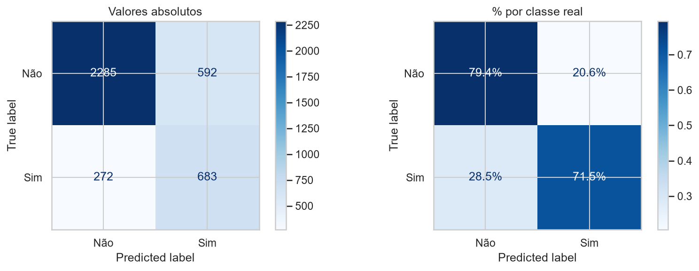
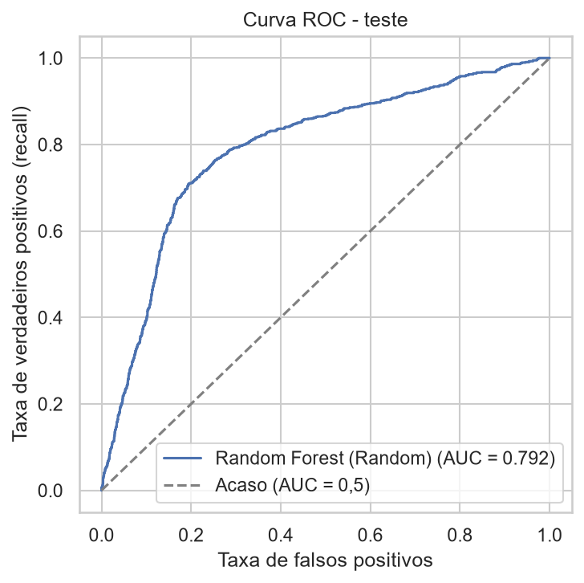

# Previsão de Mudança de Emprego (HR Job Change)

Projeto de Machine Learning em Python, desenvolvido no módulo de Machine Learning do curso **AiDAPT – Data Analytics** (Cegid Academy), seguindo a metodologia **CRISP-DM**.

**Grupo 3:** Cláudia Candeias e João Abreu · Entrega: 18/10/2026

## Problema de negócio

Uma entidade de recrutamento quer saber, entre os candidatos que fizeram uma formação, **quais estão abertos a mudar de emprego**, para concentrar os contactos em quem está recetivo em vez de contactar toda a gente. A decisão é dos RH/recrutamento: a que candidatos fazer uma proposta.

- **Tipo de problema:** classificação binária supervisionada (`procura_mudanca_emprego`: Sim/Não).
- **Dados:** 19 158 candidatos e 14 colunas (`Data/input/Dados_RH_Mudanca_Emprego.csv`). Cerca de 25 % são "Sim" (classes desequilibradas, ~3:1) e 53 % das linhas têm pelo menos um valor em falta.
- **Métrica principal:** *recall* da classe "Sim", porque falhar um candidato recetivo é pior do que fazer um contacto a mais. O F1 impede que o recall suba só por prever "Sim" para todos.
- **Critério de sucesso:** recall ≥ 0,70 e F1 ≥ 0,55, superando o baseline que prevê sempre "Não".

## Resultados

Modelo final: **Random Forest** (afinada com `RandomizedSearchCV`), com limiar de decisão de 0,55 escolhido por validação cruzada no treino. Resultados no conjunto de teste (3 832 candidatos):

| Métrica | Resultado | Meta |
|---|---|---|
| Recall (Sim) | **0,705** | ≥ 0,70 |
| F1 (Sim) | **0,617** | ≥ 0,55 |
| Precision (Sim) | 0,548 | – |
| ROC-AUC | 0,792 | – |
| Accuracy | 0,782 | baseline: 0,751 |

- **Sem overfitting:** F1 de 0,654 no treino, 0,638 na validação cruzada (desvio 0,007) e 0,613 no teste (limiar 0,5).
- **Comparação de modelos** (F1 em validação cruzada): Random Forest 0,638 · Decision Tree 0,623 · Logistic Regression 0,590 · KNN 0,461.
- **Variáveis que mais pesam:** índice de desenvolvimento da cidade, dados da empresa em falta (`dimensao_empresa`/`tipo_empresa`) e nível de educação.





### Limitações

- A **precision é modesta (0,55)**: cerca de metade dos candidatos contactados não procura mudar. Ainda assim é mais do dobro da taxa base de "Sim" (25 %).
- O modelo erra mais nos candidatos **sem dados da empresa** e **sem experiência relevante**, que são também os mais heterogéneos.
- Os dados são um retrato "do momento", sem histórico. Os resultados não se generalizam à população em geral.
- O modelo **prioriza** os candidatos; a decisão final continua a ser humana.

## Metodologia (CRISP-DM)

| Fase | Notebook | O que foi feito |
|---|---|---|
| 1. Compreensão do negócio | `01_business_understanding.ipynb` | Problema, perguntas de negócio, hipóteses, métricas e critérios de sucesso |
| 2. Compreensão dos dados | `02_data_understanding.ipynb` | Qualidade dos dados, valores em falta, distribuições, relação de cada variável com o alvo, testes estatísticos |
| 3. Preparação dos dados | `03_data_preparation.ipynb` | Limpeza, tratamento de valores em falta e outliers, criação de variáveis, codificação e escalonamento |
| 4. Modelação | `04_modeling.ipynb` | Baseline, Logistic Regression, Decision Tree, Random Forest e KNN; `GridSearchCV` e `RandomizedSearchCV` com `StratifiedKFold` (5 folds); escolha do modelo final |
| 5. Avaliação | `05_evaluation.ipynb` | Métricas no teste, overfitting, análise de erros por segmento, ajuste do limiar, importância das variáveis |
| 6. Implementação | `06_deployment.ipynb` | Previsões ordenadas por probabilidade para os RH e função de previsão para novos candidatos |

O ficheiro `preparacao.py` guarda as regras de preparação partilhadas pelas fases 3, 4 e 6, para que os dados novos sejam tratados exatamente como os de treino.

## Estrutura do repositório

```text
├── 01_business_understanding.ipynb … 06_deployment.ipynb
├── preparacao.py              # regras de preparação partilhadas
└── Data/
    ├── input/                 # dataset original
    ├── output/                # dados preparados e previsões
    └── analytics/             # gráficos gerados nos notebooks
```

## Como executar

1. Instalar Python 3.10+ e as bibliotecas: `pandas`, `numpy`, `scikit-learn`, `scipy`, `matplotlib`, `seaborn` e `joblib`.
2. Executar os notebooks **por ordem, de 01 a 06**. O modelo final é guardado no notebook 04 (em `Data/models/`), por isso os notebooks 05 e 06 dependem dele.

## Ferramentas

Python · pandas · NumPy · scikit-learn · matplotlib · seaborn · Jupyter
